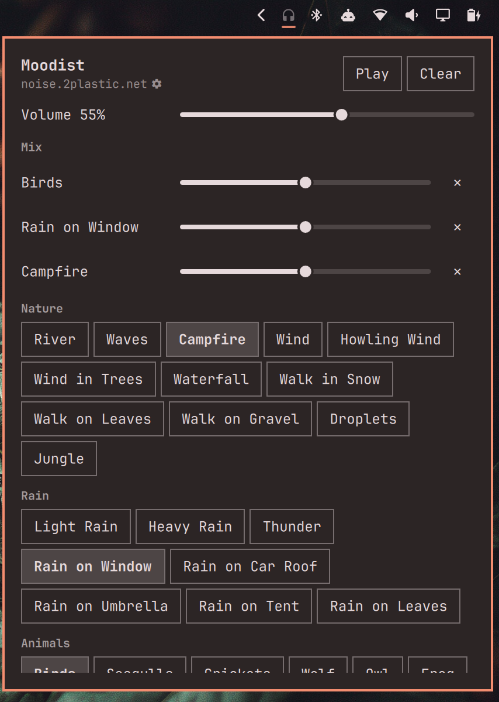
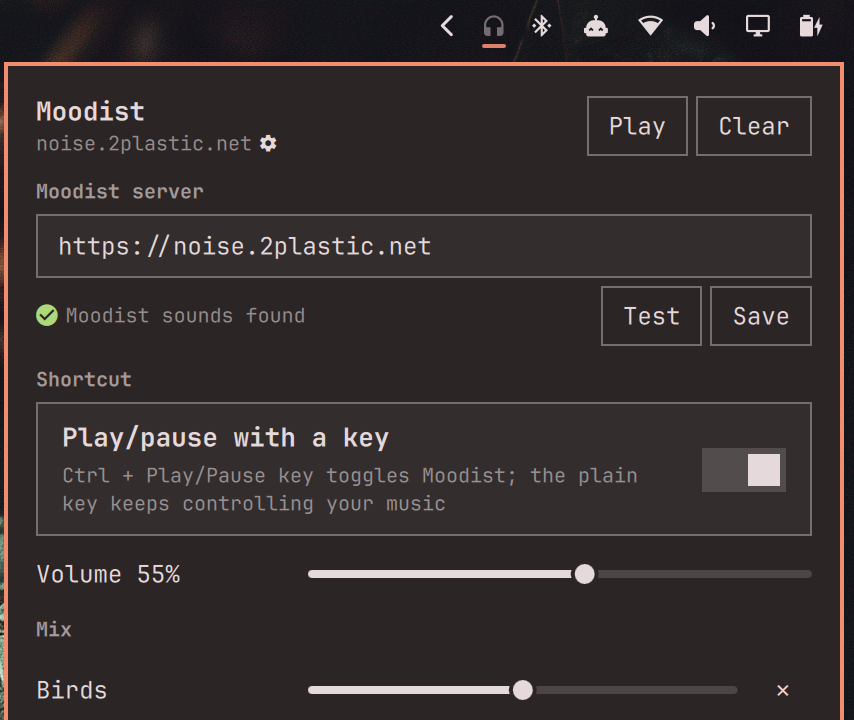

# Moodist for the Omarchy bar

An Omarchy shell bar widget that mixes ambient sounds from
[Moodist](https://github.com/remvze/moodist): rain, café chatter, brown noise
and 80 more. It plays in the bar itself, without a browser window, by streaming
the sound files from a Moodist instance.

It needs a Moodist instance to stream from. Moodist is easy to self-host
([Docker instructions](https://github.com/remvze/moodist#self-hosting)).

The plugin deliberately ships **without a default server**. Pointing every
install at the official site, <https://moodist.mvze.net>, would put this
plugin's traffic on the Moodist author's hosting, and that needs their
agreement first. Until then, please use your own instance.

<p>
  
  
</p>

## Install

```bash
omarchy plugin add <git-url-of-this-repo> --enable
```

## Use

| On the bar icon | Does |
|---|---|
| Left click | Play / pause the mix (opens the mixer if the mix is empty) |
| Right or middle click | Open the mixer |
| Scroll | Master volume |

In the mixer, click sounds to add or remove them and set each one's volume.
The mix and volumes are saved in `~/.local/state/omarchy/moodist.json` and
restored after a restart. Playback does not resume on its own.

## Use your own Moodist instance

In the mixer, click the small cog next to the server address, enter your instance's URL and press
**Test**. A check mark means the instance serves Moodist's sounds; **Save**
is enabled only then. Until a server is set, opening the mixer starts on this
row.

Or from a terminal:

```bash
omarchy bar set net.2plastic.moodist instanceUrl https://moodist.example.com
```

The instance must serve Moodist's sound files at their usual paths
(`/sounds/<category>/<name>.mp3`), which any stock Moodist deployment does.

## Play/pause key (optional)

The plain Play/Pause key keeps controlling your music and videos; Moodist is
background sound and should not take it over. Instead, the plugin can give
Moodist its own key: open the cog settings and turn on **Play/pause with a
key**, which binds **Ctrl + Play/Pause**. Omarchy leaves that combination
free.

For a different key:

```bash
omarchy bar set net.2plastic.moodist shortcut "SUPER + F12"
```

Pick a combination that nothing else uses; Hyprland runs every binding for a
key, so a taken one would do both things. The plugin registers the key at
runtime with `hyprctl eval`, puts it back after every Hyprland config
reload, and removes it when the plugin is removed. It shows up as "Moodist
play/pause" in `hyprctl binds`.

## Updating

`omarchy plugin update net.2plastic.moodist` reloads the widget right away,
but the shell keeps the running audio service, so changes to it take effect
after `omarchy restart shell` (or the next login).

## Keybindings and scripts

```bash
omarchy-shell moodist toggle        # play / pause
omarchy-shell moodist add light-rain   # add a sound by id (see sounds.json)
omarchy-shell moodist remove light-rain
omarchy-shell moodist clear
omarchy-shell moodist status        # JSON: instance, playing, mix, volume
omarchy-shell net.2plastic.moodist toggle   # open / close the mixer
```

## Sound catalogue

`sounds.json` lists the 84 sounds of Moodist's own mixer, generated from
upstream `src/data/sounds/*.tsx` at the commit named in its `source` field.
The plugin ships no audio; it streams the files from the configured instance.
Moodist's generated binaural beats are not included.

## License

MIT for this plugin. Moodist and its sounds are covered by
[Moodist's own licensing](https://github.com/remvze/moodist).
